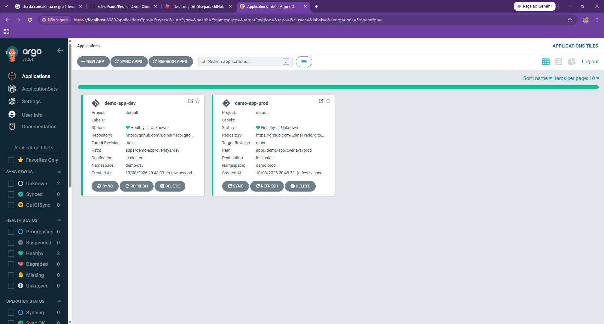
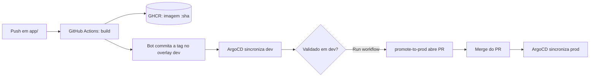
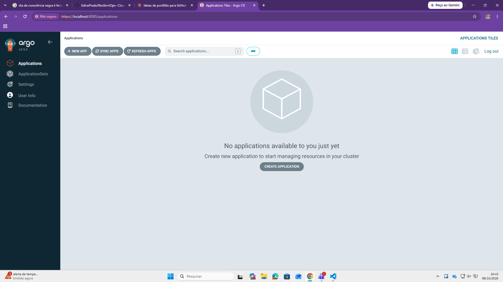
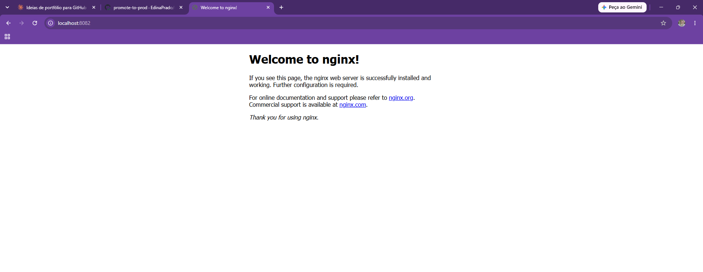
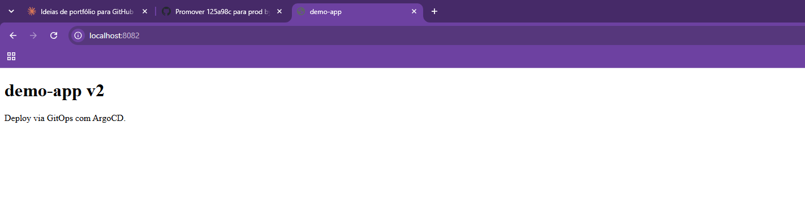

# GitOps Plataform

Pipeline GitOps completo rodando localmente em um cluster **kind**: o Git é a única fonte da verdade, o **ArgoCD** mantém o cluster sincronizado e o **GitHub Actions** cuida do build e da promoção entre ambientes.



## O problema

Deploy manual (`kubectl apply` na mão) é frágil: não deixa histórico, não tem revisão e o ambiente pode divergir do que está versionado sem ninguém perceber.

## A solução

Todo estado desejado do cluster vive neste repositório. Nada vai para o cluster sem passar por um commit, e o ArgoCD desfaz qualquer alteração feita fora do Git.

- **dev**: atualizado automaticamente a cada mudança no código
- **prod**: atualizado só depois de um pull request aprovado e mergeado

## Fluxo



## Stack

| Peça | Uso |
|---|---|
| kind | Cluster Kubernetes local (1 control-plane) |
| ArgoCD | Entrega contínua declarativa (pull-based) |
| Kustomize | Base única com overlays `dev` e `prod` |
| GitHub Actions | CI (build/push da imagem) e workflow de promoção |
| GHCR | Registry das imagens |
| nginx | App de demonstração servindo uma página estática |

## Estrutura

```
.
├── app/                       # código e Dockerfile da app
├── apps/demo-app/
│   ├── base/                  # deployment e service
│   └── overlays/
│       ├── dev/               # namespace demo-dev, 2 réplicas
│       └── prod/              # namespace demo-prod, 3 réplicas
├── argocd/
│   ├── bootstrap/             # configuração do cluster kind
│   └── applications/          # Applications do ArgoCD (dev e prod)
├── .github/workflows/
│   ├── ci.yaml                # build + atualização da tag no dev
│   └── promote.yaml           # promoção dev -> prod via PR
└── docs/                      # evidências (prints)
```

## Como rodar

Pré-requisitos: Docker, kind e kubectl.

```bash
# 1. Cluster
kind create cluster --config argocd/bootstrap/kind-config.yaml

# 2. ArgoCD
kubectl create namespace argocd
kubectl apply -n argocd --server-side -f https://raw.githubusercontent.com/argoproj/argo-cd/stable/manifests/install.yaml
kubectl wait --for=condition=available deployment/argocd-server -n argocd --timeout=300s

# 3. Applications (dev e prod)
kubectl apply -f argocd/applications/

# 4. Acesso à UI (usuário: admin)
kubectl -n argocd get secret argocd-initial-admin-secret -o jsonpath="{.data.password}" | base64 -d; echo
kubectl port-forward svc/argocd-server -n argocd 8080:443
```

Para ver a app: `kubectl port-forward svc/demo-app -n demo-dev 8081:80` (dev) ou `-n demo-prod 8082:80` (prod).

> Se fizer fork, troque o `repoURL` em `argocd/applications/*.yaml` e o nome da imagem em `.github/workflows/`.

## Evidências

**ArgoCD antes e depois de criar as Applications**

| Sem aplicações | Com `demo-app-dev` e `demo-app-prod` |
|---|---|
|  |  |

**Promoção para prod via pull request**

O workflow `promote-to-prod` lê a tag validada em dev e abre um PR alterando só o overlay de prod. Depois do merge, o ArgoCD atualiza o prod.

| Prod antes (nginx padrão) | Prod depois (demo-app v2) |
|---|---|
|  |  |

## Decisões de projeto

- **Pull, não push.** O CI nunca fala com o cluster. Ele só publica a imagem e escreve no Git; quem aplica é o ArgoCD, então o cluster não precisa expor credenciais para fora.
- **`automated` com `prune` e `selfHeal`.** Recursos removidos do Git somem do cluster e mudanças manuais são revertidas.
- **Dev automático, prod por PR.** A promoção passa por revisão humana e deixa rastro de quem aprovou e quando.
- **`paths: app/**` no CI.** O commit do bot altera `apps/`, não `app/`, então o workflow não dispara a si mesmo em loop.
- **Tag da imagem = SHA do commit.** Cada deploy é rastreável até o código que o gerou, sem usar `latest`.
- **Repositório público.** Assim o ArgoCD lê o Git sem credenciais; em um cenário real eu usaria um deploy key ou GitHub App.

## Próximos passos

- [ ] ApplicationSet para gerar as Applications por ambiente
- [ ] Argo Rollouts (canary) no prod
- [ ] Gestão de segredos com Sealed Secrets ou External Secrets
- [ ] Notificações do ArgoCD
- [ ] Proteção de branch na `main`, liberando o bot do CI como exceção
